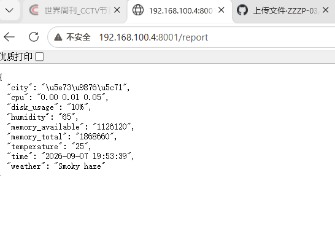
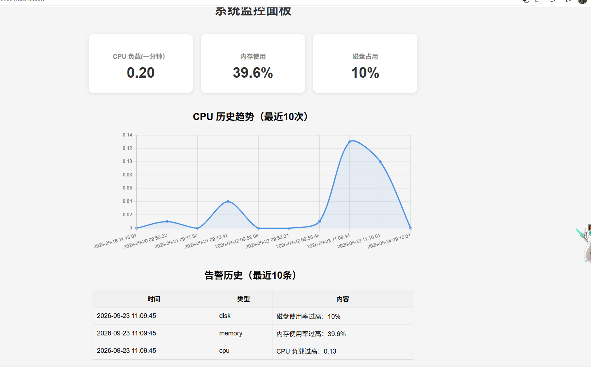

# 系统监控 API 服务

基于 Flask 的轻量级系统监控 API，支持 CPU/内存/磁盘监控、天气查询、AI 分析、微信告警、Web 仪表盘。

## 功能

- 系统状态查询：`/report`
- 城市天气查询：`/weather?city=郑州`
- 当前时间：`/now`
- 历史记录存储（MySQL）
- AI 分析系统状态：`/analyze`
- 微信告警推送（WxPusher）
- Web 监控面板：`/dashboard`
- CSV 导出历史数据：`/export`
- 登录保护

## 环境要求

- Python 3.6+
- MySQL 8.0
- Linux（需要访问 `/proc` 目录）
- Nginx（反向代理）
- systemd（服务管理）

## 部署方式

本项目支持两种部署方式，选择其中一种即可。

### 方式一：systemd（推荐，本项目当前使用）

适用于 Linux 服务器，已装好 Python 3.6+、MySQL 8.0、Nginx。

1. 安装依赖

   pip install -r requirements.txt

2. 创建数据库

   mysql -u root -p
   CREATE DATABASE monitor;
   EXIT;

3. 设置环境变量

   export DB_PASSWORD="你的MySQL密码"
   export WXPUSHER_TOKEN="你的WxPusher Token"
   export WXPUSHER_UID="你的WxPusher UID"
   export AGNES_API_KEY="你的Agnes API Key"
   export DASHBOARD_PASSWORD="你的登录密码"

4. 建表

   python3 init_db.py

5. 配置 systemd 服务（`/etc/systemd/system/monitor.service`）

   ```ini
   [Unit]
   Description=Flask Monitor Service
   After=network.target mysqld.service

   [Service]
   Type=simple
   WorkingDirectory=/root/monitor
   Environment="DB_PASSWORD=你的密码"
   Environment="WXPUSHER_TOKEN=你的token"
   Environment="WXPUSHER_UID=你的uid"
   Environment="AGNES_API_KEY=你的key"
   Environment="DASHBOARD_PASSWORD=你的登录密码"
   ExecStart=/usr/bin/python3 /root/monitor/api_flask.py
   Restart=always
   RestartSec=5

   [Install]
   WantedBy=multi-user.target

### 方式二：Docker Compose（适合新电脑）

需要 Linux 内核 4.x 以上，比如 Ubuntu 20.04 以上、CentOS 8 以上、Windows 装了 Docker Desktop。

    cp .env.example .env
    vi .env
    docker-compose up -d

然后访问 `http://localhost:8001/report`。

注意：CentOS 7 全系列内核都是 3.10，Docker 桥接网络可能不兼容，建议用 Ubuntu 20.04 以上。

## 接口列表

| 接口 | 方法 | 说明 |
|------|------|------|
| `/report` | GET | 返回 CPU、内存、磁盘、天气 |
| `/weather?city=北京` | GET | 指定城市的天气 |
| `/now` | GET | 当前时间 |
| `/analyze` | GET | 调用 AI 分析系统状态 |
| `/history` | GET | 最近 10 条历史记录 |
| `/export` | GET | 导出最近 100 条记录为 CSV |
| `/dashboard` | GET | Web 监控面板（需要登录） |
| `/login` | GET/POST | 登录页 |
| `/logout` | GET | 退出登录 |
| `/test_alert` | GET | 测试微信告警推送 |

## 项目结构

    monitor/
    ├── api_flask.py          核心代码
    ├── init_db.py            建表脚本
    ├── collecter.py          定时采集脚本
    ├── Dockerfile            Docker 构建文件
    ├── docker-compose.yml    Docker Compose 配置
    ├── requirements.txt      依赖列表
    ├── templates/
    │   ├── index.html        仪表盘页面
    │   └── login.html        登录页
    └── README.md

## 依赖

- Flask
- requests
- pymysql

## 运行效果






## 技术博客

[从零搭建监控系统：用 WxPusher 实现微信告警](https://blog.csdn.net/zzp_03/article/details/166680906)
